# Formal Rules & Specification Document: NLP Course Project
## Problem Statement 4: BERT Word Embeddings for Cross-Project Software Story Point Estimation with Temporal Ordering

---

### Document Information
- **Document Version:** 1.0.0 (Authoritative Specification)
- **Role:** Lead Rules & Specification Auditor
- **Target Audience:** Development Team, QA Auditors, Project Evaluators, Viva Defense Panel
- **Primary Source:** `Project Guidelines.pdf` (Natural Language Processing: Project List and Problem Statements)
- **Dataset Reference:** TAWOS (Technical and Agile Work-item Open Source) Dataset ([DOI: 10.5522/04/21308124](https://doi.org/10.5522/04/21308124))
- **Status:** Final & Enforced

---

## Table of Contents
1. [Problem Statement 4: Official Definition & Core Requirements](#1-problem-statement-4-official-definition--core-requirements)
2. [Authoritative Project Naming & Canonical Database Mappings](#2-authoritative-project-naming--canonical-database-mappings)
3. [Master Register of 39 Cross-Project Pairs](#3-master-register-of-39-cross-project-pairs)
4. [Model Architecture & Text Representation Specifications](#4-model-architecture--text-representation-specifications)
5. [Dataset Splitting Protocol & Expanding-Window Cross-Validation](#5-dataset-splitting-protocol--expanding-window-cross-validation)
6. [Formal Mathematical Evaluation Metrics & Reporting Templates](#6-formal-mathematical-evaluation-metrics--reporting-templates)
7. [Submission Deliverables Checklist & Viva Defense Guide](#7-submission-deliverables-checklist--viva-defense-guide)

---

## 1. Problem Statement 4: Official Definition & Core Requirements

### 1.1 Formal Definition
Per Section 2 (Project List and Problem Statements, Page 2) of `Project Guidelines.pdf`, **Problem Statement 4** is defined as:

> **"Evaluate BERT-based word embeddings for predicting story points of later issues in a target project using source-project training data and chronological ordering."**

### 1.2 Core Experimental Dimensions
Problem Statement 4 operates at the intersection of three rigorous experimental constraints:

| Dimension | Specification | Implementation Requirements |
| :--- | :--- | :--- |
| **Text Representation** | **Word Embeddings (BERT)** | Contextual token-level embeddings extracted from `bert-base-uncased`, aggregated via mean-pooling into a dense 768-dimensional vector representation per issue description. |
| **Project Setting** | **Cross-Project Estimation** | Training data is strictly derived from a **source project**, while evaluation is performed on a completely disjoint **target project** ($P_{\text{source}} \neq P_{\text{target}}$). Evaluated across all 39 cross-project pairs defined in Section 3.3. |
| **Data Splitting** | **Temporal Ordering** | All issue records are sorted strictly chronologically by creation timestamp ($\text{Creation\_Date ASC}$). Training uses older historical issues, and testing evaluates on later, unseen future issues. Absolutely **zero date leakage** is permitted. |
| **Evaluation Metrics** | **MAE & MdAE** | Primary error quantification via Mean Absolute Error (MAE) and Median Absolute Error (MdAE) reported across both 5-fold temporal validation and held-out test partitions. |

### 1.3 Comparative Representation Requirements
Per Section 3.1 and Section 3.4 of the guidelines, to rigorously evaluate the effectiveness of BERT-based word embeddings, the primary model must be systematically benchmarked against two comparative representations:
1. **Primary Representation:** BERT Word Embeddings (768-dimensional contextual token representations pooled to document level).
2. **Comparison 1:** SBERT Sentence Embeddings (384-dimensional dense semantic sentence embeddings from `all-MiniLM-L6-v2`).
3. **Comparison 2:** Combined BERT + SBERT Embeddings (1152-dimensional fused representation concatenating token-level and sentence-level vectors).

---

## 2. Authoritative Project Naming & Canonical Database Mappings

The TAWOS SQL dump (`TAWOS.sql`) contains 44 project tables. The project guidelines specify 39 distinct projects for cross-project evaluation. Discrepancies between guideline terminology and database schema names must be resolved deterministically.

### 2.1 Mandatory Renaming Rules
The following four mappings are **mandatory and inviolable** across all extraction scripts, configuration files, and validation suites:

#### Rule 1: "Evergreen" $\to$ "The MongoDB Engineering" (Project ID 43, Key `EVG`)
- **Guideline Name:** `Evergreen`
- **TAWOS Database Name:** `The MongoDB Engineering`
- **TAWOS Project ID:** `43`
- **TAWOS Project Key:** `EVG`
- **Technical Context:** Evergreen is MongoDB's open-source distributed continuous integration and test automation framework. In Jira and the TAWOS database schema, this project was cataloged under the umbrella organizational name *"The MongoDB Engineering"* with key `EVG`.

#### Rule 2: "C++ driver (Appcelerator)" $\to$ "Aptana Studio" (Project ID 8, Key `APSTUD`)
- **Guideline Name:** `C++ driver (Appcelerator)`
- **TAWOS Database Name:** `Aptana Studio`
- **TAWOS Project ID:** `8`
- **TAWOS Project Key:** `APSTUD`
- **Technical Context:** Appcelerator acquired Aptana Inc. in 2011 to integrate Aptana Studio (an open-source web development IDE) into the Titanium mobile platform suite. In TAWOS, project ID 8 with key `APSTUD` represents Aptana Studio. The guideline label *"C++ driver (Appcelerator)"* maps directly to this Appcelerator ecosystem project ID 8.

#### Rule 3: "C++ driver (MongoDB)" $\to$ "The Mongo C++ driver" (Project ID 31, Key `CXX`)
- **Guideline Name:** `C++ driver (MongoDB)`
- **TAWOS Database Name:** `The Mongo C++ driver`
- **TAWOS Project ID:** `31`
- **TAWOS Project Key:** `CXX`
- **Technical Context:** Canonical official MongoDB C++ client driver repository in TAWOS.

#### Rule 4: "Java driver" $\to$ "The Mongo Java driver" (Project ID 32, Key `JAVA`)
- **Guideline Name:** `Java driver`
- **TAWOS Database Name:** `The Mongo Java driver`
- **TAWOS Project ID:** `32`
- **TAWOS Project Key:** `JAVA`
- **Technical Context:** Canonical official MongoDB Java client driver repository in TAWOS.

---

### 2.2 Complete 39-Project Authoritative Registry

The following table provides the definitive bijection between the 39 project names listed in `Project Guidelines.pdf`, the actual TAWOS database records, their project keys, IDs, and valid issue counts ($SP > 0$):

| Project ID | Project Key | Guideline Name | TAWOS Database Name | Total Issues | Valid Issues ($SP > 0$) | Mapping Notes |
| :---: | :---: | :--- | :--- | :---: | :---: | :--- |
| **1** | `XD` | XD | Spring XD | 3,707 | 3,542 | TAWOS prepends 'Spring ' |
| **2** | `DATACASS` | DataCass | Spring DataCass | 798 | 216 | TAWOS prepends 'Spring ' |
| **3** | `NEXUS` | Nexus | Sonatype Nexus | 9,912 | 1,804 | TAWOS prepends 'Sonatype ' |
| **4** | `MESOS` | MESOS | Apache Mesos | 10,157 | 3,268 | TAWOS prepends 'Apache ' |
| **5** | `USERGRID` | Usergrid | Apache Usergrid | 1,339 | 482 | TAWOS prepends 'Apache ' |
| **6** | `MXNET` | MXNet | Apache MXNet | 1,404 | 205 | TAWOS prepends 'Apache ' |
| **7** | `ALOY` | Alloy Framework | Alloy Framework | 1,519 | 303 | Exact match |
| **8** | `APSTUD` | C++ driver (Appcelerator) | Aptana Studio | 8,135 | 839 | **Mandatory mapping (Rule 2)** |
| **9** | `CLI` | Command-Line Interface | Command-Line Interface | 645 | 357 | Exact match |
| **10** | `DAEMON` | Appcelerator Daemon | Appcelerator Daemon | 313 | 242 | Exact match |
| **11** | `TIDOC` | Titanium Mobile Platform | Titanium Mobile Platform | 3,059 | 1,280 | Exact match |
| **12** | `TIMOB` | The Titanium SDK | The Titanium SDK | 22,059 | 4,422 | Exact match |
| **13** | `TISTUD` | Appcelerator Studio | Appcelerator Studio | 5,979 | 3,295 | Exact match |
| **14** | `BAM` | Bamboo | Atlassian Bamboo | 14,252 | 516 | TAWOS prepends 'Atlassian ' |
| **15** | `CLOV` | Clover | Atlassian Clover | 1,501 | 382 | TAWOS prepends 'Atlassian ' |
| **16** | `CWD` | Crowd | Atlassian Crowd | 4,311 | 213 | TAWOS prepends 'Atlassian ' |
| **17** | `FE` | FishEye | Atlassian FishEye | 5,533 | 217 | TAWOS prepends 'Atlassian ' |
| **18** | `JRASERVER`| Jira Server | Atlassian Jira Server | 44,165 | 373 | TAWOS prepends 'Atlassian ' |
| **19** | `JSWCLOUD` | Software Cloud | Atlassian Software Cloud | 11,702 | 296 | TAWOS prepends 'Atlassian ' |
| **20** | `JSWSERVER`| Atlassian Software Server | Atlassian Atlassian Software Server | 12,862 | 326 | TAWOS duplicate 'Atlassian ' |
| **21** | `CONFCLOUD`| Confluence Cloud | Atlassian Confluence Cloud | 23,409 | 340 | TAWOS prepends 'Atlassian ' |
| **22** | `CONFSERVER`| Confluence Server | Atlassian Confluence Server | 42,324 | 645 | TAWOS prepends 'Atlassian ' |
| **23** | `BE` | Blockchain Explorer | Hyperledger Blockchain Explorer | 802 | 372 | TAWOS prepends 'Hyperledger ' |
| **24** | `FAB` | Fabric | Hyperledger Fabric | 13,682 | 627 | TAWOS prepends 'Hyperledger ' |
| **25** | `INDY` | Indy Node | Hyperledger Indy Node | 2,321 | 677 | TAWOS prepends 'Hyperledger ' |
| **26** | `IS` | Indy SDK | Hyperledger Indy SDK | 1,531 | 708 | TAWOS prepends 'Hyperledger ' |
| **27** | `STL` | Sawtooth | Hyperledger Sawtooth | 1,663 | 950 | TAWOS prepends 'Hyperledger ' |
| **28** | `DM` | Lsstcorp Data management | Lsstcorp Data management | 26,506 | 20,064 | Exact match |
| **29** | `DURACLOUD` | Lyrasis Dura Cloud | Lyrasis Dura Cloud | 1,125 | 657 | Exact match |
| **30** | `COMPASS` | Compass | MongoDB Compass | 1,791 | 499 | TAWOS prepends 'MongoDB ' |
| **31** | `CXX` | C++ driver (MongoDB) | The Mongo C++ driver | 2,032 | 212 | **Mandatory mapping (Rule 3)** |
| **32** | `JAVA` | Java driver | The Mongo Java driver | 3,560 | 238 | **Mandatory mapping (Rule 4)** |
| **33** | `SERVER` | MongoDB Core Server | MongoDB Core Server | 48,663 | 743 | Exact match |
| **34** | `MDL` | Moodle | Moodle | 66,741 | 1,528 | Exact match |
| **35** | `APIKIT` | Mule APIkit | Mule APIkit | 886 | 465 | Exact match (distinct from Mule) |
| **36** | `MULE` | Mule | Mule | 11,816 | 3,694 | Exact match (distinct from APIkit) |
| **42** | `DNN` | DotNetNuke Platform | DotNetNuke Platform | 10,060 | 2,585 | Exact match |
| **43** | `EVG` | Evergreen | The MongoDB Engineering | 10,299 | 5,069 | **Mandatory mapping (Rule 1)** |
| **44** | `JRACLOUD` | Jira Cloud | Atlassian Jira Cloud | 25,669 | 352 | TAWOS prepends 'Atlassian ' |
| **TOTAL** | — | **39 Projects** | — | **427,330** | **63,003** | **100% Bijective Coverage** |

---

## 3. Master Register of 39 Cross-Project Pairs

Per Section 3.3 (Cross-project training and testing pairs, Pages 3–5) of `Project Guidelines.pdf`, all experiments must evaluate the assigned **39 cross-project training and testing pairs**. This guarantees that **every project serves as training data at least once** and as testing data at least once.


### 3.1 Exhaustive 39 Pairs Specification Table

| Pair # | Source Project (Guideline Name) | Source ID | Source Key | Target Project (Guideline Name) | Target ID | Target Key | Mapping Resolution Notes |
| :---: | :--- | :---: | :---: | :--- | :---: | :---: | :--- |
| **01** | XD | 1 | `XD` | MESOS | 4 | `MESOS` | Canonical match |
| **02** | Usergrid | 5 | `USERGRID` | MXNet | 6 | `MXNET` | Canonical match |
| **03** | Titanium Mobile Platform | 11 | `TIDOC` | Usergrid | 5 | `USERGRID` | Canonical match |
| **04** | The Titanium SDK | 12 | `TIMOB` | Alloy Framework | 7 | `ALOY` | Canonical match |
| **05** | Software Cloud | 19 | `JSWCLOUD` | Appcelerator Daemon | 10 | `DAEMON` | Canonical match |
| **06** | Sawtooth | 27 | `STL` | Appcelerator Studio | 13 | `TISTUD` | Canonical match |
| **07** | Nexus | 3 | `NEXUS` | Command-Line Interface | 9 | `CLI` | Canonical match |
| **08** | MXNet | 6 | `MXNET` | The Titanium SDK | 12 | `TIMOB` | Canonical match |
| **09** | Mule APIkit | 35 | `APIKIT` | Titanium Mobile Platform | 11 | `TIDOC` | Canonical match |
| **10** | Mule | 36 | `MULE` | C++ driver (Appcelerator) | 8 | `APSTUD` | Target $\to$ Aptana Studio (Rule 2) |
| **11** | Moodle | 34 | `MDL` | Atlassian Software Server | 20 | `JSWSERVER` | Canonical match |
| **12** | MongoDB Core Server | 33 | `SERVER` | Bamboo | 14 | `BAM` | Canonical match |
| **13** | MESOS | 4 | `MESOS` | Clover | 15 | `CLOV` | Canonical match |
| **14** | Lyrasis Dura Cloud | 29 | `DURACLOUD`| Confluence Cloud | 21 | `CONFCLOUD` | Canonical match |
| **15** | Lsstcorp Data management | 28 | `DM` | Confluence Server | 22 | `CONFSERVER`| Canonical match |
| **16** | Jira Server | 18 | `JRASERVER`| Crowd | 16 | `CWD` | Canonical match |
| **17** | Jira Cloud | 44 | `JRACLOUD` | FishEye | 17 | `FE` | Canonical match |
| **18** | Java driver | 32 | `JAVA` | Jira Cloud | 44 | `JRACLOUD` | Source $\to$ The Mongo Java driver (Rule 4) |
| **19** | Indy SDK | 26 | `IS` | Jira Server | 18 | `JRASERVER`| Canonical match |
| **20** | Indy Node | 25 | `INDY` | Software Cloud | 19 | `JSWCLOUD` | Canonical match |
| **21** | FishEye | 17 | `FE` | DotNetNuke Platform | 42 | `DNN` | Canonical match |
| **22** | Fabric | 24 | `FAB` | Blockchain Explorer | 23 | `BE` | Canonical match |
| **23** | Evergreen | 43 | `EVG` | Fabric | 24 | `FAB` | Source $\to$ The MongoDB Engineering (Rule 1) |
| **24** | DotNetNuke Platform | 42 | `DNN` | Indy Node | 25 | `INDY` | Canonical match |
| **25** | DataCass | 2 | `DATACASS` | Indy SDK | 26 | `IS` | Canonical match |
| **26** | Crowd | 16 | `CWD` | Sawtooth | 27 | `STL` | Canonical match |
| **27** | Confluence Server | 22 | `CONFSERVER`| Lsstcorp Data management | 28 | `DM` | Canonical match |
| **28** | Confluence Cloud | 21 | `CONFCLOUD` | Lyrasis Dura Cloud | 29 | `DURACLOUD`| Canonical match |
| **29** | Compass | 30 | `COMPASS` | MongoDB Core Server | 33 | `SERVER` | Canonical match |
| **30** | Command-Line Interface | 9 | `CLI` | Compass | 30 | `COMPASS` | Canonical match |
| **31** | Clover | 15 | `CLOV` | C++ driver (MongoDB) | 31 | `CXX` | Target $\to$ The Mongo C++ driver (Rule 3) |
| **32** | C++ driver (Appcelerator) | 8 | `APSTUD` | Evergreen | 43 | `EVG` | Source $\to$ Aptana Studio; Target $\to$ The MongoDB Engineering |
| **33** | C++ driver (MongoDB) | 31 | `CXX` | Java driver | 32 | `JAVA` | Source $\to$ Mongo C++; Target $\to$ Mongo Java |
| **34** | Blockchain Explorer | 23 | `BE` | Moodle | 34 | `MDL` | Canonical match |
| **35** | Bamboo | 14 | `BAM` | Mule | 36 | `MULE` | Canonical match |
| **36** | Atlassian Software Server | 20 | `JSWSERVER` | Mule APIkit | 35 | `APIKIT` | Canonical match |
| **37** | Appcelerator Studio | 13 | `TISTUD` | Nexus | 3 | `NEXUS` | Canonical match |
| **38** | Appcelerator Daemon | 10 | `DAEMON` | DataCass | 2 | `DATACASS` | Canonical match |
| **39** | Alloy Framework | 7 | `ALOY` | XD | 1 | `XD` | Canonical match |

---

## 4. Model Architecture & Text Representation Specifications

### 4.1 Input Text Cleaning & Tokenization
For every issue, the text input is formed by concatenating the issue `Title` and `Description_Text`:
$$\text{RawText}_i = \text{Title}_i \oplus \text{" "} \oplus \text{Description\_Text}_i$$
1. **Markup Stripping:** Remove Jira formatting syntax (`{code}`, `{noformat}`, `bq.`, `*bold*`, `_italic_`), raw stack traces, base64 strings, and hexadecimal dumps.
2. **URL & Email Redaction:** Replace hyperlinks with a neutral token `[URL]` and emails with `[EMAIL]`.
3. **Whitespace Normalization:** Collapse multiple spaces, tabs, and newline sequences into single spaces.
4. **Length Filtering:** Discard issues where $\text{len}(\text{CleanText}_i) < 5$ characters.
5. **Token Truncation:** Subword tokenization bounded by $L_{\max} = 512$ tokens.

---

### 4.2 Primary Architecture: BERT Word Embeddings (Mean-Pooled)


#### Token-Level Contextual Representations
- **Base Architecture:** `bert-base-uncased` (Devlin et al., 2019).
- **Parameters:** 12 transformer encoder layers, 768 hidden dimensions ($d=768$), 12 self-attention heads, 110M parameters.
- **Forward Pass:** For an issue sequence of $L$ tokens, the model computes contextualized representations for every token $l \in \{1, \dots, L\}$:
  $$\mathbf{H} = \text{BERT}(\text{tokens}) \in \mathbb{R}^{B \times L \times 768}$$
  where $\mathbf{h}_l \in \mathbb{R}^{768}$ denotes the contextual token embedding at position $l$.

#### Token Pooling Strategy: Mean-Pooling
Per the requirements of word embeddings in the project guidelines, token-level representations must be aggregated to form a fixed-size document vector. Mean pooling over all unmasked tokens is applied:
$$\mathbf{e}_{\text{BERT}} = \frac{\sum_{l=1}^{L} m_l \mathbf{h}_l}{\sum_{l=1}^{L} m_l} \in \mathbb{R}^{768}$$
where $m_l \in \{0, 1\}$ is the attention mask entry ($m_l = 1$ for valid tokens, $m_l = 0$ for padding tokens).

> [!IMPORTANT]
> **Why Mean-Pooling over `[CLS]` for Story Points?**
> The `[CLS]` token representation in pre-trained BERT without task-specific fine-tuning is primarily shaped by the Next Sentence Prediction (NSP) objective and does not effectively summarize technical complexity. Mean-pooling over all token vectors acts as an information-dense contextual bag-of-words, preserving signals from technical domain keywords (e.g., *"deadlock"*, *"refactor"*, *"migration"*, *"null pointer"*) distributed across the description.

---

### 4.3 Comparison Architecture 1: SBERT Sentence Embeddings
- **Base Architecture:** `sentence-transformers/all-MiniLM-L6-v2` (Reimers & Gurevych, 2019).
- **Parameters:** 6 transformer layers, 384 hidden dimensions ($d=384$), 22.7M parameters.
- **Objective:** Specifically fine-tuned on >1 billion sentence pairs using contrastive loss to capture semantic similarity.
- **Representation:** Directly outputs a dense 384-dimensional semantic embedding:
  $$\mathbf{e}_{\text{SBERT}} = \text{SBERT}(\text{CleanText}_i) \in \mathbb{R}^{384}$$
- **Characteristics:** Highly efficient inference; excels at capturing global semantic intent but may smooth out individual technical keyword frequencies that indicate software complexity.

---

### 4.4 Comparison Architecture 2: Combined BERT + SBERT (Concatenation Fusion)
To investigate whether granular token-level context and sentence-level semantics provide complementary signals, feature-level concatenation is performed:
$$\mathbf{e}_{\text{Combined}} = \left[ \mathbf{e}_{\text{BERT}} \,\|\, \mathbf{e}_{\text{SBERT}} \right] \in \mathbb{R}^{1152}$$
- **Dimensionality:** $768 + 384 = 1152$ dimensions.
- **Normalization:** Prior to regression fitting, each feature dimension is standardized:
  $$\tilde{\mathbf{x}} = \frac{\mathbf{x} - \boldsymbol{\mu}_{\text{train}}}{\boldsymbol{\sigma}_{\text{train}} + \epsilon}$$
  where $\boldsymbol{\mu}_{\text{train}}$ and $\boldsymbol{\sigma}_{\text{train}}$ are computed strictly on the training partition and applied to validation/test sets to prevent data leakage.

---

### 4.5 Downstream Prediction Components (Regressors)
Per Section 3.1 of `Project Guidelines.pdf`, machine learning regression models (or a 3-layer Convolutional Neural Network) are fitted on top of the extracted feature vectors:

1. **Ridge Regression (L2 Regularized Linear Model):**
   $$\min_{\mathbf{w}} \|\mathbf{y} - \mathbf{X}\mathbf{w}\|_2^2 + \alpha \|\mathbf{w}\|_2^2$$
   - Hyperparameter grid: $\alpha \in \{0.01, 0.1, 1.0, 10.0, 100.0\}$.
   - Provides a stable linear baseline that prevents overfitting in high-dimensional embedding spaces.

2. **Random Forest Regressor (Non-linear Ensemble):**
   $$\hat{y}_i = \frac{1}{B} \sum_{b=1}^{B} T_b(\mathbf{x}_i)$$
   - Hyperparameters: $n\_estimators \in \{100, 200\}$, $max\_depth \in \{10, 20, \text{None}\}$.
   - Captures non-linear feature interactions and threshold effects across embedding dimensions.

3. **XGBoost Regressor (Gradient Boosted Decision Trees):**
   $$\mathcal{L}^{(t)} = \sum_{i=1}^{N} \left[ g_i f_t(\mathbf{x}_i) + \frac{1}{2} h_i f_t^2(\mathbf{x}_i) \right] + \Omega(f_t)$$
   - Hyperparameters: $n\_estimators \in \{100, 200\}$, $max\_depth \in \{3, 5, 7\}$, $learning\_rate \in \{0.05, 0.1\}$.
   - State-of-the-art tree boosting with explicit leaf-weight regularization ($\lambda, \gamma$).

4. **Optional Deep Regressor (3-Layer CNN):**
   - Layer 1: Conv1D ($\text{filters}=128$, $\text{kernel\_size}=3$, ReLU) + MaxPool1D
   - Layer 2: Conv1D ($\text{filters}=64$, $\text{kernel\_size}=3$, ReLU) + GlobalMaxPool1D
   - Layer 3: Dense($32$, ReLU) + Dropout($0.3$) + Dense($1$, Linear)

---

## 5. Dataset Splitting Protocol & Expanding-Window Cross-Validation

### 5.1 Temporal Ordering & The Zero Date Leakage Invariant
In real-world software development, an estimation model trained on historical tickets predicts the effort of future incoming tickets. Models cannot travel backward in time.

```mermaid
flowchart LR
    subgraph Timeline [Chronological Timeline (Creation_Date ASC)]
        direction LR
        DevSet["80% Development Set (Source Project Historical Issues)"] -->|Cutoff Timestamp: t_split| TestSet["20% Held-out Test Set (Target Project Future Issues)"]
    end
```

#### Deterministic Ordering
All issues within every project are sorted deterministically:
$$\text{SortOrder}(r) = \Big(\text{Creation\_Date}(r) \text{ ASC}, \; \text{ID}(r) \text{ ASC}\Big)$$

#### Inviolable Zero Date Leakage Constraint
For every cross-project pair $(P_{\text{source}}, P_{\text{target}})$:
$$\max_{i \in \text{Dev}} \Big(\text{Creation\_Date}(i)\Big) \le \min_{j \in \text{Test}} \Big(\text{Creation\_Date}(j)\Big)$$
$$\text{Dev} \cap \text{Test} = \emptyset$$

---

### 5.2 5-Fold Expanding-Window Cross-Validation (Walk-Forward Validation)
Standard $K$-Fold cross-validation randomly shuffles data, training on future tickets and predicting past tickets. This produces severe temporal leakage and artificially deflated error metrics.

To satisfy Section 3.2 of the guidelines while preserving chronological causality, the 80% development set ($N_{\text{dev}}$ issues) is evaluated using **5-Fold Expanding-Window (Forward-Chaining) Validation**:

```mermaid
gantt
    title 5-Fold Temporal Expanding-Window Cross-Validation
    dateFormat  X
    axisFormat %s
    section Fold 1
    Train Fold 1 (Window 1) :active, f1_tr, 0, 20
    Val Fold 1 (Window 2)   :crit,   f1_val, 20, 36
    section Fold 2
    Train Fold 2 (Windows 1-2) :active, f2_tr, 0, 36
    Val Fold 2 (Window 3)     :crit,   f2_val, 36, 52
    section Fold 3
    Train Fold 3 (Windows 1-3) :active, f3_tr, 0, 52
    Val Fold 3 (Window 4)     :crit,   f3_val, 52, 68
    section Fold 4
    Train Fold 4 (Windows 1-4) :active, f4_tr, 0, 68
    Val Fold 4 (Window 5)     :crit,   f4_val, 68, 84
    section Fold 5
    Train Fold 5 (Windows 1-5) :active, f5_tr, 0, 84
    Val Fold 5 (Window 6)     :crit,   f5_val, 84, 100
```



#### Formal Mathematical Definition of Folds
Given $N_{\text{dev}}$ sorted issues indexed $0, 1, \dots, N_{\text{dev}}-1$, define window size:
$$W = \left\lfloor \frac{N_{\text{dev}}}{K + 1} \right\rfloor = \left\lfloor \frac{N_{\text{dev}}}{6} \right\rfloor \quad (\text{for } K = 5)$$

For fold $k \in \{1, 2, 3, 4, 5\}$:
1. **Training Partition Indices:**
   $$I_{\text{train}}^{(k)} = \Big\{ 0, 1, \dots, (k \cdot W) - 1 \Big\}$$
2. **Validation Partition Indices:**
   $$I_{\text{val}}^{(k)} = \begin{cases} 
   \Big\{ k \cdot W, \dots, ((k + 1) \cdot W) - 1 \Big\} & \text{if } k < 5 \\
   \Big\{ k \cdot W, \dots, N_{\text{dev}} - 1 \Big\} & \text{if } k = 5 
   \end{cases}$$

#### Strict Temporal Invariants
Across all 5 folds:
1. $\text{Size}(I_{\text{train}}^{(1)}) < \text{Size}(I_{\text{train}}^{(2)}) < \dots < \text{Size}(I_{\text{train}}^{(5)})$ (Expanding training history)
2. $I_{\text{train}}^{(k)} \cap I_{\text{val}}^{(k)} = \emptyset$ (Disjoint partitions)
3. $\max_{i \in I_{\text{train}}^{(k)}} \text{Creation\_Date}(i) \le \min_{j \in I_{\text{val}}^{(k)}} \text{Creation\_Date}(j)$ (Strict causal temporal validity)

---

## 6. Formal Mathematical Evaluation Metrics & Reporting Templates

### 6.1 Mean Absolute Error (MAE)
The Mean Absolute Error measures the average magnitude of absolute point discrepancies between actual and predicted story points:
$$\text{MAE} = \frac{1}{N} \sum_{i=1}^{N} \big| y_i - \hat{y}_i \big|$$
- **Unit:** Story points (linear scale).
- **Behavior:** Directly penalizes all errors proportionally to their absolute distance. Highly sensitive to extreme outliers and huge estimation misses.

### 6.2 Median Absolute Error (MdAE)
The Median Absolute Error measures the 50th percentile of absolute estimation errors:
$$\text{MdAE} = \text{median}\Big( \big\{ |y_1 - \hat{y}_1|, |y_2 - \hat{y}_2|, \dots, |y_N - \hat{y}_N| \big\} \Big)$$
- **Formal Sorting Formulation:** Order absolute residuals $e_i = |y_i - \hat{y}_i|$ such that $e_{(1)} \le e_{(2)} \le \dots \le e_{(N)}$:
  $$\text{MdAE} = \begin{cases} 
  e_{\left(\frac{N+1}{2}\right)} & \text{if } N \text{ is odd} \\[8pt]
  \dfrac{e_{\left(\frac{N}{2}\right)} + e_{\left(\frac{N}{2} + 1\right)}}{2} & \text{if } N \text{ is even}
  \end{cases}$$
- **Behavior:** Highly robust to heavy-tailed distributions and extreme agile outliers (e.g., mislabeled epics with 100+ points).

> [!NOTE]
> **Interpretation of MAE vs. MdAE Gap:**
> In software story point datasets, $\text{MAE} \gg \text{MdAE}$ is universally observed. This occurs because the distribution of story points in Jira is severely right-skewed (majority of issues are 1, 2, 3, 5, or 8 points, while occasional outliers reach 40, 100, or higher). A small MdAE alongside a higher MAE proves the model accurately predicts everyday agile issues, while a few severe under-estimations on massive tickets inflate the arithmetic mean.

---

### 6.3 Cross-Validation Statistics Across Folds
For each model configuration evaluated over the 5 folds:
- **Validation Fold Scores:** $\{\text{MAE}_1, \dots, \text{MAE}_5\}$ and $\{\text{MdAE}_1, \dots, \text{MdAE}_5\}$.
- **Cross-Validation Mean:**
  $$\mu_{\text{MAE}} = \frac{1}{5} \sum_{k=1}^{5} \text{MAE}_k, \quad \mu_{\text{MdAE}} = \frac{1}{5} \sum_{k=1}^{5} \text{MdAE}_k$$
- **Sample Standard Deviation:**
  $$\sigma_{\text{MAE}} = \sqrt{\frac{1}{4} \sum_{k=1}^{5} (\text{MAE}_k - \mu_{\text{MAE}})^2}, \quad \sigma_{\text{MdAE}} = \sqrt{\frac{1}{4} \sum_{k=1}^{5} (\text{MdAE}_k - \mu_{\text{MdAE}})^2}$$
- **Reporting Format:** $\mu \pm \sigma$ (e.g., $3.421 \pm 0.315$).

---

### 6.4 Authoritative Comparative Results Table Template (Section 3.4)

Per Section 3.4 of `Project Guidelines.pdf`, the final deliverables must include the following comparative evaluation table reporting results across representations and regressors:

```markdown
| Representation | Model configuration | 5-Fold CV MAE (mean ± std) | 5-Fold CV MdAE (mean ± std) | Held-Out Test MAE | Held-Out Test MdAE |
| :--- | :--- | :---: | :---: | :---: | :---: |
| **BERT word embeddings** | Ridge Regression (alpha=1.0, mean-pooling, 768-dim) | Report | Report | Report | Report |
| **BERT word embeddings** | Random Forest (n=200, depth=20, mean-pooling, 768-dim) | Report | Report | Report | Report |
| **BERT word embeddings** | XGBoost (n=200, depth=5, lr=0.1, mean-pooling, 768-dim) | Report | Report | Report | Report |
| **SBERT sentence embeddings** | Ridge Regression (alpha=1.0, all-MiniLM-L6-v2, 384-dim) | Report | Report | Report | Report |
| **SBERT sentence embeddings** | Random Forest (n=200, depth=20, all-MiniLM-L6-v2, 384-dim) | Report | Report | Report | Report |
| **SBERT sentence embeddings** | XGBoost (n=200, depth=5, lr=0.1, all-MiniLM-L6-v2, 384-dim) | Report | Report | Report | Report |
| **Combined BERT + SBERT** | Ridge Regression (alpha=1.0, concat fusion, 1152-dim) | Report | Report | Report | Report |
| **Combined BERT + SBERT** | Random Forest (n=200, depth=20, concat fusion, 1152-dim) | Report | Report | Report | Report |
| **Combined BERT + SBERT** | XGBoost (n=200, depth=5, lr=0.1, concat fusion, 1152-dim) | Report | Report | Report | Report |
```

---

## 7. Submission Deliverables Checklist & Viva Defense Guide

### 7.1 Mandatory Submission Checklist (Sections 3.5, 3.6, 3.7)

- [ ] **GitHub Repository Structure:**
  - `README.md` containing: Project title, team members, problem statement definition, dataset description, setup instructions, and reproduction guide.
  - `config.yaml` specifying all model names, seeds (default: 42), batch sizes, hyperparameters, and split configurations.
  - `requirements.txt` with exact pinned library versions.
  - Complete source code / Jupyter notebook (`story_point_estimation.ipynb`).
- [ ] **Data & Mappings Deliverables:**
  - `issues.csv` containing all 63,003 valid issues across all 39 projects with non-null text, valid ISO timestamps, and story points $> 0$.
  - `projects.csv` & `project_mappings.csv` documenting all 39 projects, metadata, and the 39 cross-project pairs.
  - Verified mandatory project mappings (Evergreen $\to$ The MongoDB Engineering, C++ driver Appcelerator $\to$ Aptana Studio, Mongo driver naming).
- [ ] **Experimental Integrity Deliverables:**
  - Strict zero date leakage verified across all 39 pairs: $\max(\text{Dev}) \le \min(\text{Test})$.
  - Strict chronological expanding-window 5-fold cross-validation implemented on the 80% development set.
  - Zero ID overlap between train, validation, and test sets.
- [ ] **Final Report (PDF format):**
  - GitHub repository URL displayed prominently on the first page.
  - Problem definition, methodology, architecture diagrams, and experimental setup.
  - Comparative evaluation tables reporting 5-fold CV ($\mu \pm \sigma$) and held-out test MAE/MdAE.
  - Limitations, threats to validity, and discussion.
  - Zero fabricated results (backed by reproducible code and execution logs).

---

### 7.2 Viva Defense Talking Points: Deep Technical Justifications

During the final viva evaluation, the panel will probe the theoretical and empirical justifications of our methodology. The following talking points provide deep technical answers:

#### Talking Point 1: Why does BERT Token Mean-Pooling work effectively for Story Point Estimation?
* **Question from Panel:** *"Why did you use token-level word embeddings with mean-pooling instead of just using the `[CLS]` token or static word embeddings like Word2Vec?"*
* **Authoritative Defense:**
  1. **Limitations of `[CLS]` Without Fine-Tuning:** In pre-trained BERT, `[CLS]` is trained on Next Sentence Prediction (NSP). Without end-to-end task-specific backpropagation, the `[CLS]` embedding often collapses into an anisotropic cone in vector space and fails to represent granular sentence semantics.
  2. **Limitations of Static Word2Vec/GloVe:** Static embeddings assign a single static vector to a polysemous word. In software engineering, words like *"driver"*, *"thread"*, *"pool"*, *"leak"*, and *"table"* have drastically different meanings depending on context. BERT's bidirectional multi-head self-attention computes contextualized token representations where *"memory leak"* is distinctly encoded from *"data leak"*.
  3. **Why Mean-Pooling Captures Effort Signals:** Software story points correlate strongly with two dimensions:
     - *Syntactic Complexity / Scope:* Longer tickets containing extensive specifications, logs, or multi-step acceptance criteria.
     - *Semantic Severity:* High concentrations of complex technical operations (*"refactor"*, *"deadlock"*, *"concurrency"*, *"race condition"*, *"database migration"*).
     Mean-pooling aggregates the contextual vectors of all valid tokens, acting as a dense contextualized bag-of-concepts that effectively preserves both lexical complexity and semantic scope.

---

#### Talking Point 2: Why does Temporal Ordering yield significantly higher error than Random Splitting? (Concept Drift & Temporal Decay)
* **Question from Panel:** *"Why are your MAE and MdAE metrics substantially higher under temporal ordering compared to published baselines that use random train/test splits?"*
* **Authoritative Defense:**
  1. **The Fallacy of Random Splitting in Software Engineering:** In random splitting, tickets from the exact same development sprint or release version are randomly scattered into both train and test partitions. The model effectively memorizes contemporaneous team composition, active sprint terminology, and short-term developer velocity. This constitutes severe data leakage and produces artificially optimistic, ungeneralizable performance.
  2. **Temporal Decay and Real-World Causality:** Temporal splitting models actual deployment reality: training on historical tickets to predict upcoming tickets. In practice, software projects experience severe **concept drift**:
     - *Velocity & Point Calibration Drift:* As agile teams mature, their estimation calibration shifts. What was estimated as 8 story points in Year 1 may be estimated as 3 points in Year 3 due to accumulated domain knowledge or team member turnover.
     - *Vocabulary & Architecture Evolution:* As software evolves, dependencies, libraries, and microservice architectures are introduced (e.g., migrating from monolithic callbacks to reactive streams). Older training data lacks this emerging vocabulary, causing out-of-distribution shifts.
     - *Lifecycle Drift:* Early in a project's lifecycle, tickets focus on large architectural epics and major feature modules (skewed toward high story points: 8, 13, 20). Late in a project's lifecycle, tickets predominantly focus on minor bug patches, regression fixes, and maintenance (skewed toward low story points: 1, 2, 3).
  3. **Conclusion:** Higher error under chronological splitting is not a failure of the model; it is the accurate reflection of temporal concept drift and the true difficulty of future effort forecasting.

---

#### Talking Point 3: Why does Cross-Project Generalization suffer from Domain Shift?
* **Question from Panel:** *"Why is cross-project estimation harder than within-project estimation, and how do embeddings help or struggle with domain shift?"*
* **Authoritative Defense:**
  1. **Arbitrary and Relative Nature of Story Points:** Unlike physical units (hours, kilograms, meters), story points are non-standardized, subjective units defined relative to each individual team's baseline. For example, in Apache Mesos (distributed systems infrastructure in C++), a 5-point story might represent 3 weeks of complex kernel synchronization. In Moodle (PHP web learning management system), a 5-point story might represent adding a quiz form field. No machine learning model can predict the exact numerical point value without knowing the target team's specific scaling factor.
  2. **Vocabulary Domain Mismatch:** Even with contextual embeddings, the domain vocabulary differs radically across projects. Training on Spring XD (data streaming, Hadoop connectors, distributed pipelines) does not fully equip a model to understand ticket descriptions in Apache Mesos (cgroups, OS resource isolation) or Aptana Studio (IDE UI syntax highlighting, Eclipse plugins).
  3. **Value of Pre-trained Semantic Embeddings:** Despite domain shift, pre-trained BERT and SBERT embeddings outperform lexical $n$-gram/TF-IDF models because they capture underlying linguistic abstractions of task complexity (e.g., distinguishing simple descriptive UI changes from multi-step systemic refactoring) that partially transfer across software domains.

---

## 8. Verification and Forensic Audit Compliance

This specification is programmatically verified by the automated verification suite `verify_data.py`:
- **AC 1 (Issues File Integrity):** 63,003 valid issues across 39 projects, zero NULLs, all $SP > 0$.
- **AC 2 (Project Mappings Integrity):** 39/39 projects verified, mandatory renamings confirmed.
- **AC 3 (39 Cross-Project Pairs Partitioning):** All 39 pair directories structured in `data/splits/`.
- **AC 4 (Temporal Splitting & Zero Date Leakage):** Verified zero date leakage across all 39 pairs and all 195 temporal folds ($\max(\text{train}) \le \min(\text{val}) \le \min(\text{test})$).
- **AC 5 (Validation Exit Code):** Programmatic return code 0, 100% test pass rate.

**Enforcement:** Any deviation from these rules invalidates experimental reproducibility and project acceptance.
